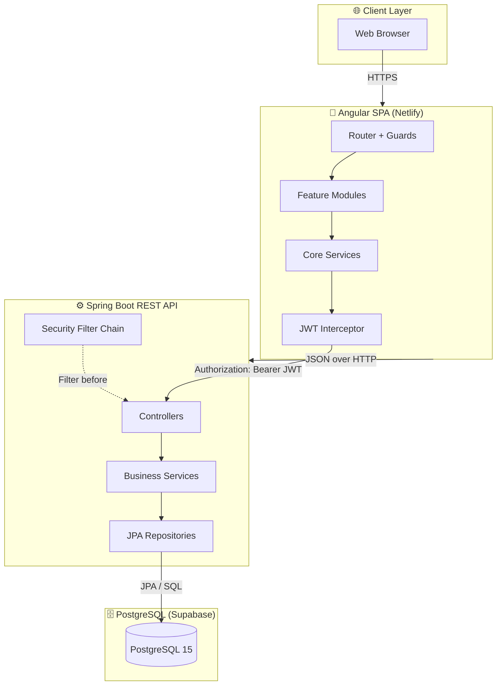
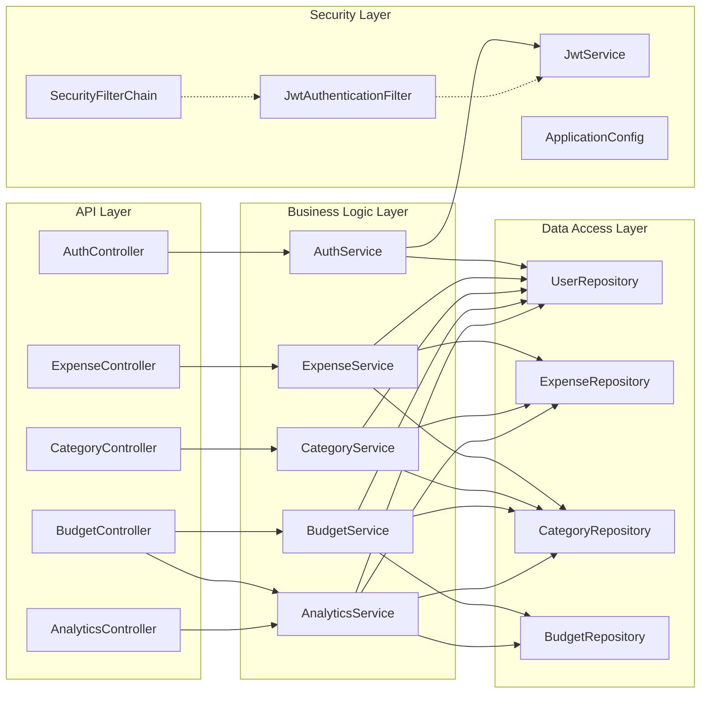
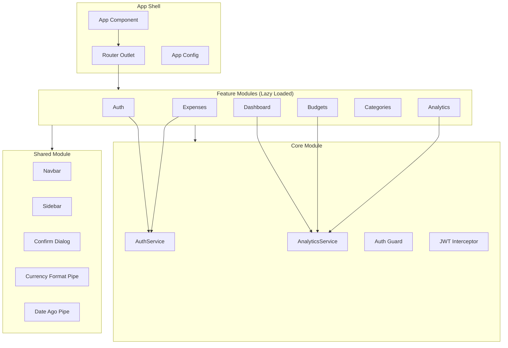
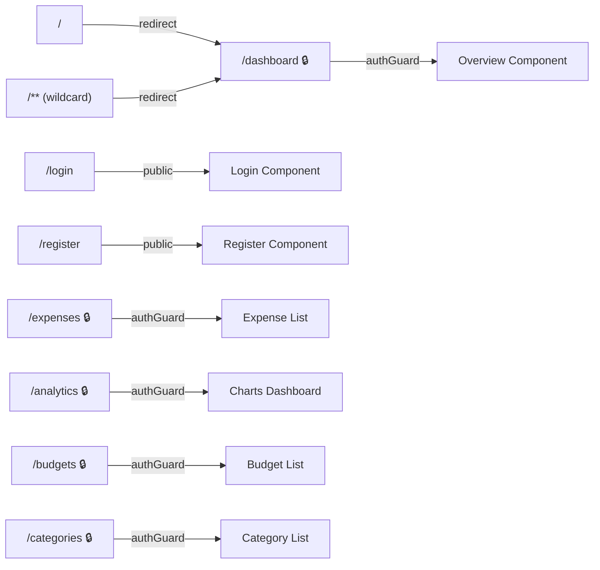
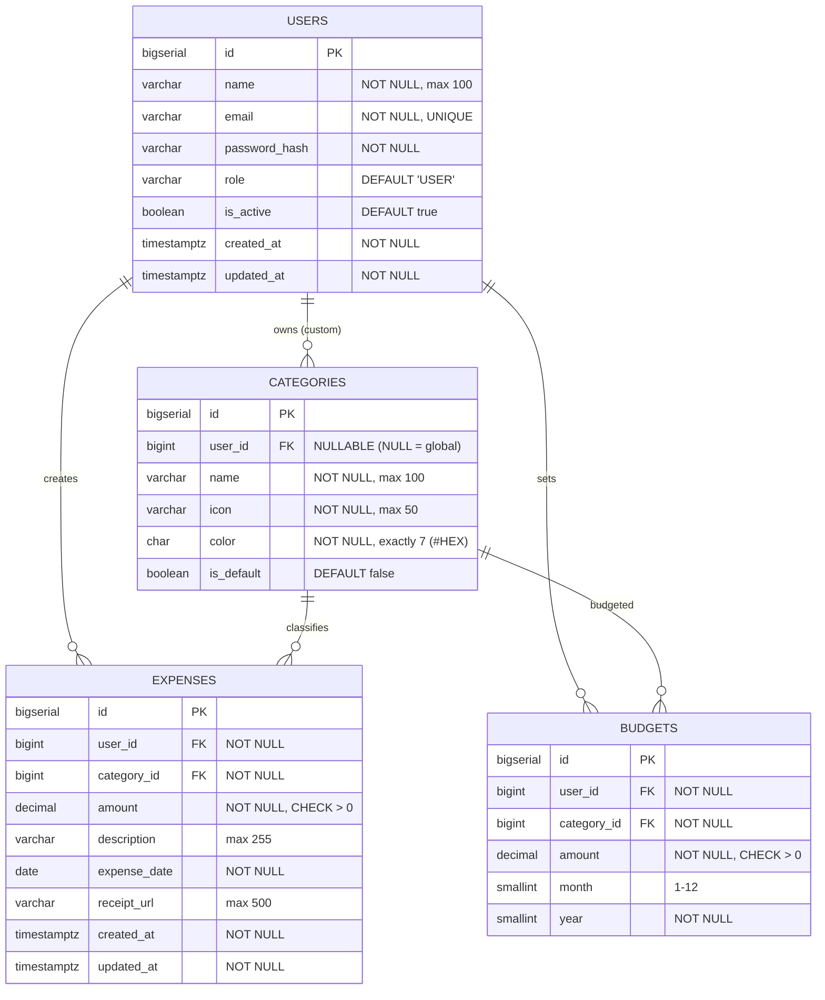
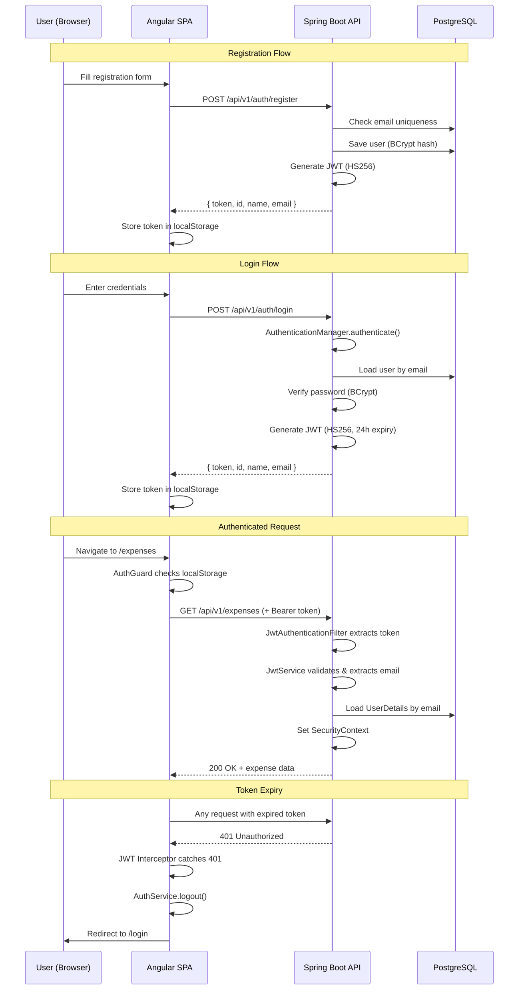
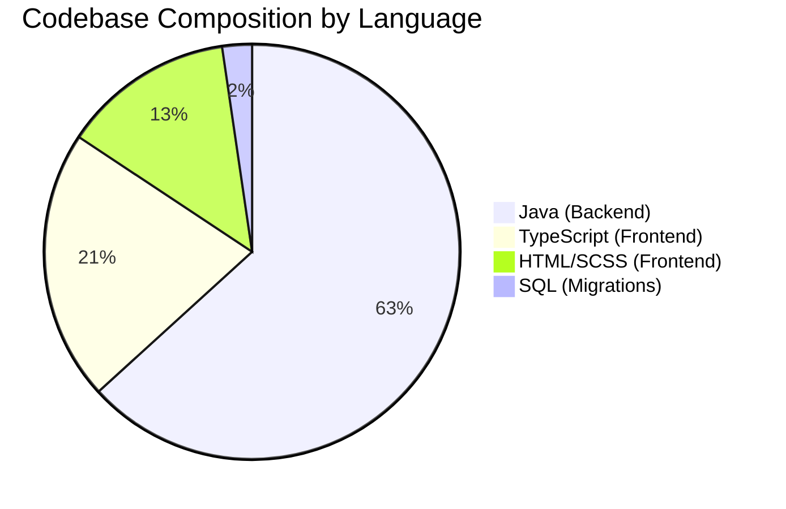
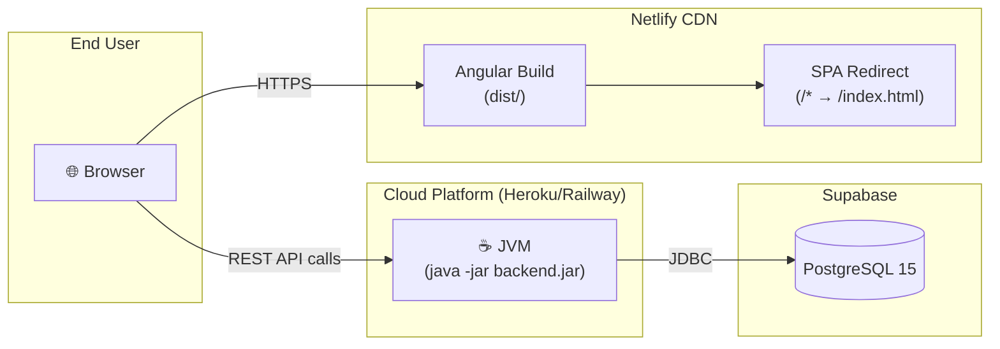

<p align="center">
  
  
  
  
  
</p>

# 📊 Expense Tracker — Project Report

> A full-stack personal finance web application that allows users to **track**, **categorise**, **budget**, and **analyse** their spending habits with interactive charts, PDF/CSV exports, and secure JWT authentication.

---

## 📑 Table of Contents

- [Project Overview](#-project-overview)
- [Key Features](#-key-features)
- [Technology Stack](#-technology-stack)
- [System Architecture](#-system-architecture)
- [High-Level Architecture Diagram](#-high-level-architecture-diagram)
- [Backend Architecture](#-backend-architecture)
- [Frontend Architecture](#-frontend-architecture)
- [Database Design](#-database-design)
- [Authentication & Security Flow](#-authentication--security-flow)
- [REST API Reference](#-rest-api-reference)
- [Project Structure](#-project-structure)
- [Codebase Statistics](#-codebase-statistics)
- [Deployment Architecture](#-deployment-architecture)
- [Setup & Installation](#-setup--installation)
- [Design Patterns Used](#-design-patterns-used)
- [Default Categories](#-default-categories)

---

## 🎯 Project Overview

Expense Tracker is a **production-ready**, full-stack web application built with a decoupled **Angular SPA** frontend and a **Spring Boot REST API** backend. The application empowers users to manage their personal finances through intuitive expense tracking, budget management, and rich analytics — all secured with stateless JWT-based authentication.

| Aspect | Details |
|---|---|
| **Architecture** | Decoupled SPA + REST API (Client-Server) |
| **Authentication** | Stateless JWT (HS256, 24h expiry) |
| **Database** | PostgreSQL 15 hosted on Supabase |
| **Schema Management** | Flyway versioned migrations |
| **API Documentation** | SpringDoc OpenAPI (Swagger UI) |
| **Export Formats** | CSV, PDF (OpenPDF) |

---

## ✨ Key Features

### 🔐 Authentication & User Management
- **JWT-based stateless authentication** — no server-side sessions
- User registration with **BCrypt password hashing**
- Automatic token injection via Angular HTTP interceptor
- Route guard protection for authenticated pages
- Automatic logout on 401 responses

### 💸 Expense Management
- Full **CRUD operations** (Create, Read, Update, Delete)
- Multi-filter support: **category**, **date range**, **keyword search**
- Server-side **pagination** via Spring Data
- Receipt URL attachment support
- **CSV export** with date range filtering
- **PDF export** with formatted table reports (OpenPDF)

### 📁 Category Management
- **9 pre-seeded default categories** (Food, Transport, Housing, etc.)
- User-created **custom categories** with icon & colour customisation
- Protection: default categories cannot be edited or deleted
- Referential integrity: categories with expenses cannot be deleted

### 💰 Budget Management
- Set **monthly budgets per category**
- **Upsert logic** — update existing or create new budgets seamlessly
- Budget vs. Actual **spending comparison** with percentage calculations
- Owner-verified delete operations

### 📈 Analytics & Visualisations
- **Category Breakdown** — pie chart of spending by category (monthly)
- **Monthly Trend** — bar chart of spending across 12 months
- **Daily Trend** — line chart of daily spending within a month
- **Yearly Summary** — YTD total, largest month, projected annual total
- **Budget Progress** — per-category budget utilisation dashboard
- Powered by **Chart.js** + **ng2-charts** on the frontend

---

## 🛠 Technology Stack

### Frontend

| Technology | Version | Purpose |
|---|---|---|
| **Angular** | 21.2 | SPA framework (standalone components) |
| **TypeScript** | 5.9 | Type-safe JavaScript |
| **Angular Material** | 21.2 | UI component library (Material Design 3) |
| **Angular CDK** | 21.2 | Component Dev Kit utilities |
| **Chart.js** | 4.5 | Canvas-based charting library |
| **ng2-charts** | 10.0 | Angular wrapper for Chart.js |
| **RxJS** | 7.8 | Reactive programming |
| **SCSS** | — | CSS pre-processor for styling |
| **Vitest** | 4.0 | Unit testing framework |
| **Prettier** | 3.8 | Code formatter |

### Backend

| Technology | Version | Purpose |
|---|---|---|
| **Spring Boot** | 4.1.0 | Application framework |
| **Java** | 17 | Programming language |
| **Spring Security** | 6.x | Authentication & authorisation |
| **Spring Data JPA** | — | ORM & data access layer |
| **Hibernate** | — | JPA implementation |
| **Flyway** | — | Database schema migration |
| **JJWT** | 0.12.5 | JWT token creation & validation |
| **OpenPDF** | 1.3.32 | PDF report generation |
| **SpringDoc OpenAPI** | 2.5.0 | Swagger UI / API documentation |
| **Lombok** | — | Boilerplate code reduction |
| **PostgreSQL Driver** | — | JDBC database connectivity |
| **Maven** | — | Build & dependency management |

### Database & Infrastructure

| Technology | Purpose |
|---|---|
| **PostgreSQL 15** | Relational database |
| **Supabase** | Cloud-hosted PostgreSQL (BaaS) |
| **Netlify** | Frontend deployment (SPA hosting) |
| **Heroku / Railway** | Backend deployment (Procfile-based) |

---

## 🏗 System Architecture

The system follows a **layered client-server architecture** with a clear separation of concerns between the Angular frontend and Spring Boot backend, communicating exclusively via RESTful JSON APIs.

### 🔷 High-Level Architecture Diagram



---

## ⚙️ Backend Architecture

The backend follows a **strict layered architecture** with clear responsibility boundaries. Each layer communicates only with its adjacent layer.



### Layer Responsibilities

| Layer | Package | Responsibility |
|---|---|---|
| **API** | `controller` | HTTP routing, request validation, DTO mapping, response serialisation |
| **Business Logic** | `service` | Core domain logic, expense aggregation, budget calculations, PDF/CSV generation |
| **Data Access** | `repository` | Spring Data JPA interfaces, custom JPQL queries, projections |
| **Security** | `security` | JWT filter chain, token validation, CORS, stateless session management |
| **DTOs** | `dto.request` / `dto.response` | Input validation beans, API response shapes |
| **Domain** | `model` | JPA entities mapped to database tables |
| **Exception** | `exception` | `@ControllerAdvice` global error handling, custom exception types |

---

## 📱 Frontend Architecture

The Angular frontend uses a **feature-based modular architecture** with standalone components and lazy-loaded routes.



### Frontend Feature Breakdown

| Feature | Components | Description |
|---|---|---|
| **Auth** | `Login`, `Register` | User authentication forms |
| **Dashboard** | `Overview`, `BudgetProgress` | Home dashboard with budget progress cards |
| **Expenses** | `ExpenseList`, `ExpenseFormDialog` | Expense CRUD with filters, pagination |
| **Budgets** | `BudgetList`, `SetBudgetDialog` | Monthly budget management per category |
| **Categories** | `CategoryList`, `AddCategoryDialog` | Category CRUD with icon/colour pickers |
| **Analytics** | `ChartsDashboard`, `CategoryPie`, `MonthlyBar`, `DailyLine` | Interactive Chart.js visualisations |

### Routing & Route Guards



> 🔒 = Protected by `authGuard` — redirects to `/login` if no token present.

---

## 🗃 Database Design

The application uses **4 core tables** with well-defined foreign key relationships, managed through Flyway versioned migrations.

### Entity-Relationship Diagram



### Database Constraints & Indexes

| Constraint | Table | Description |
|---|---|---|
| `UNIQUE(email)` | `users` | Prevents duplicate accounts |
| `CHECK(amount > 0)` | `expenses`, `budgets` | Enforces positive monetary values |
| `CHECK(month BETWEEN 1 AND 12)` | `budgets` | Valid month range |
| `UNIQUE(user_id, category_id, month, year)` | `budgets` | One budget per category per month |
| `ON DELETE CASCADE` | All FKs | Cascading deletes for data integrity |
| `idx_expenses_user_id` | `expenses` | Performance index for user lookups |

### Flyway Migrations

| Version | File | Description |
|---|---|---|
| V1 | `V1__create_schema.sql` | Creates all 4 tables with constraints and indexes |
| V2 | `V2__seed_default_categories.sql` | Seeds 9 default expense categories |

---

## 🔐 Authentication & Security Flow

The application uses a **stateless JWT authentication** flow with Spring Security 6's filter chain architecture.

### Authentication Sequence



### Security Configuration

| Feature | Implementation |
|---|---|
| **CSRF** | Disabled (stateless API) |
| **CORS** | Allowed origin: `http://localhost:4200` |
| **Session** | `STATELESS` — no server-side sessions |
| **Public Endpoints** | `/api/v1/auth/**`, Swagger UI endpoints |
| **Protected Endpoints** | All other routes require valid JWT |
| **Password Hashing** | BCrypt via Spring Security's `PasswordEncoder` |
| **Token Algorithm** | HMAC-SHA256 (HS256) |
| **Token Expiry** | 24 hours (86,400,000 ms) |

---

## 📡 REST API Reference

Base URL: `http://localhost:8080/api/v1`

### Authentication

| Method | Endpoint | Description | Auth |
|---|---|---|---|
| `POST` | `/auth/register` | Register a new user | ❌ |
| `POST` | `/auth/login` | Login with credentials | ❌ |

### Expenses

| Method | Endpoint | Description | Auth |
|---|---|---|---|
| `GET` | `/expenses` | List expenses (paginated, filterable) | ✅ |
| `GET` | `/expenses/{id}` | Get single expense by ID | ✅ |
| `POST` | `/expenses` | Create a new expense | ✅ |
| `PUT` | `/expenses/{id}` | Update an existing expense | ✅ |
| `DELETE` | `/expenses/{id}` | Delete an expense | ✅ |
| `GET` | `/expenses/export/csv` | Export expenses as CSV | ✅ |
| `GET` | `/expenses/export/pdf` | Export expenses as PDF | ✅ |

**Query Parameters** for `GET /expenses`:

| Parameter | Type | Description |
|---|---|---|
| `categoryId` | Long | Filter by category |
| `startDate` | ISO Date | Filter from date |
| `endDate` | ISO Date | Filter to date |
| `search` | String | Search in description |
| `page` | int | Page number (0-indexed) |
| `size` | int | Page size |
| `sort` | String | Sort field and direction |

### Categories

| Method | Endpoint | Description | Auth |
|---|---|---|---|
| `GET` | `/categories` | List all categories (default + custom) | ✅ |
| `POST` | `/categories` | Create a custom category | ✅ |
| `PUT` | `/categories/{id}` | Update a custom category | ✅ |
| `DELETE` | `/categories/{id}` | Delete a custom category | ✅ |

### Budgets

| Method | Endpoint | Description | Auth |
|---|---|---|---|
| `GET` | `/budgets?month=&year=` | List budgets for a month | ✅ |
| `POST` | `/budgets` | Create or update a budget | ✅ |
| `DELETE` | `/budgets/{id}` | Delete a budget | ✅ |
| `GET` | `/budgets/summary?month=&year=` | Budget vs. actual spending summary | ✅ |

### Analytics

| Method | Endpoint | Description | Auth |
|---|---|---|---|
| `GET` | `/analytics/category-breakdown?month=&year=` | Spending breakdown by category | ✅ |
| `GET` | `/analytics/monthly-trend?year=` | Monthly spending trend for a year | ✅ |
| `GET` | `/analytics/daily?month=&year=` | Daily spending within a month | ✅ |
| `GET` | `/analytics/yearly-summary` | Year-to-date summary & projection | ✅ |

### Error Responses

All errors follow a consistent structure:

```json
{
  "timestamp": "2026-06-24T14:30:00",
  "message": "Expense not found",
  "details": "NOT_FOUND"
}
```

| HTTP Status | Error Code | Trigger |
|---|---|---|
| `400` | `BAD_REQUEST` | Validation failure, invalid arguments |
| `403` | `FORBIDDEN` | Unauthorised resource access |
| `404` | `NOT_FOUND` | Resource doesn't exist |
| `409` | `CONFLICT` | Business rule violation (e.g., category in use) |
| `500` | `INTERNAL_SERVER_ERROR` | Unexpected server error |

---

## 📂 Project Structure

```
Expense Tracker/
├── 📄 README.md                          # Quick-start guide
├── 📄 PROJECT_REPORT.md                  # This file — detailed report
├── 📄 .gitignore
│
├── 📁 backend/                           # Spring Boot REST API
│   ├── 📄 pom.xml                        # Maven dependencies
│   ├── 📄 Procfile                       # Heroku deployment config
│   └── 📁 src/main/
│       ├── 📁 java/com/example/backend/
│       │   ├── 📄 BackendApplication.java
│       │   ├── 📁 controller/            # REST Controllers (5 files)
│       │   │   ├── AuthController.java
│       │   │   ├── ExpenseController.java
│       │   │   ├── CategoryController.java
│       │   │   ├── BudgetController.java
│       │   │   └── AnalyticsController.java
│       │   ├── 📁 service/               # Business Logic (5 files)
│       │   │   ├── AuthService.java
│       │   │   ├── ExpenseService.java
│       │   │   ├── CategoryService.java
│       │   │   ├── BudgetService.java
│       │   │   └── AnalyticsService.java
│       │   ├── 📁 repository/            # Data Access (4 files)
│       │   │   ├── UserRepository.java
│       │   │   ├── ExpenseRepository.java
│       │   │   ├── CategoryRepository.java
│       │   │   └── BudgetRepository.java
│       │   ├── 📁 model/                 # JPA Entities (4 files)
│       │   │   ├── User.java             # implements UserDetails
│       │   │   ├── Expense.java
│       │   │   ├── Category.java
│       │   │   └── Budget.java
│       │   ├── 📁 dto/
│       │   │   ├── 📁 request/           # Input DTOs (5 files)
│       │   │   └── 📁 response/          # Output DTOs (8 files)
│       │   ├── 📁 security/              # Security Config (4 files)
│       │   │   ├── SecurityConfig.java
│       │   │   ├── JwtAuthenticationFilter.java
│       │   │   ├── JwtService.java
│       │   │   └── ApplicationConfig.java
│       │   └── 📁 exception/             # Error Handling (3 files)
│       │       ├── GlobalExceptionHandler.java
│       │       ├── ResourceNotFoundException.java
│       │       └── UnauthorisedException.java
│       └── 📁 resources/
│           ├── 📄 application.yml        # App configuration
│           └── 📁 db/migration/          # Flyway SQL migrations
│               ├── V1__create_schema.sql
│               └── V2__seed_default_categories.sql
│
└── 📁 frontend/                          # Angular SPA
    ├── 📄 package.json                   # npm dependencies
    ├── 📄 angular.json                   # Angular CLI config
    ├── 📄 netlify.toml                   # Netlify deployment config
    └── 📁 src/
        ├── 📄 main.ts                    # Bootstrap entry point
        ├── 📄 index.html
        ├── 📄 styles.scss                # Global styles
        ├── 📄 _variables.scss            # SCSS design tokens
        ├── 📁 environments/
        │   └── environment.ts            # API base URL config
        └── 📁 app/
            ├── 📄 app.ts                 # Root component
            ├── 📄 app.routes.ts          # Route definitions
            ├── 📄 app.config.ts          # Providers config
            ├── 📁 core/                  # Singleton services & guards
            │   ├── 📁 services/
            │   │   ├── auth.service.ts
            │   │   └── analytics.service.ts
            │   ├── 📁 guards/
            │   │   └── auth.guard.ts
            │   └── 📁 interceptors/
            │       └── jwt.interceptor.ts
            ├── 📁 features/              # Lazy-loaded feature modules
            │   ├── 📁 auth/              # Login, Register
            │   ├── 📁 dashboard/         # Overview, Budget Progress
            │   ├── 📁 expenses/          # Expense List, Form Dialog
            │   ├── 📁 budgets/           # Budget List, Set Dialog
            │   ├── 📁 categories/        # Category List, Add Dialog
            │   └── 📁 analytics/         # Charts Dashboard, Pie, Bar, Line
            └── 📁 shared/                # Reusable components & pipes
                ├── 📁 components/
                │   ├── navbar/
                │   ├── sidebar/
                │   └── confirm-dialog/
                └── 📁 pipes/
                    ├── currency-format-pipe.ts
                    └── date-ago-pipe.ts
```

---

## 📊 Codebase Statistics

| Metric | Count |
|---|---|
| **Backend Source Files** | 43 |
| **Frontend Source Files** | 68 |
| **Total Source Files** | 111 |
| **Backend Lines of Code** | ~1,529 |
| **Frontend Lines of Code** | ~833 |
| **Total Lines of Code** | **~2,362** |
| **REST API Endpoints** | 18 |
| **JPA Entities** | 4 |
| **Angular Components** | 14 |
| **Flyway Migrations** | 2 |
| **Custom JPQL Queries** | 5 |

### Technology Distribution



---

## 🚀 Deployment Architecture



| Component | Platform | Configuration File |
|---|---|---|
| **Frontend** | Netlify | `netlify.toml` — SPA redirect rule |
| **Backend** | Heroku / Railway | `Procfile` — `java -jar target/backend-0.0.1-SNAPSHOT.jar` |
| **Database** | Supabase | `application.yml` — JDBC connection string |

---

## 🧰 Setup & Installation

### Prerequisites

| Tool | Minimum Version |
|---|---|
| Java JDK | 17+ |
| Node.js | 18+ |
| npm | 9+ |
| PostgreSQL | 15+ (or Supabase account) |

### 1. Database Setup

1. Create a free-tier project on [Supabase](https://supabase.com)
2. Collect connection credentials (host, port, dbname, user, password)
3. Update `backend/src/main/resources/application.yml`:
   ```yaml
   spring:
     datasource:
       url: jdbc:postgresql://<HOST>:<PORT>/<DBNAME>
       username: <USER>
       password: <PASSWORD>
   ```

### 2. Backend

```bash
cd backend
# Windows
./mvnw.cmd spring-boot:run
# macOS/Linux
./mvnw spring-boot:run
```

The API starts at `http://localhost:8080`. Swagger UI available at `http://localhost:8080/swagger-ui.html`.

### 3. Frontend

```bash
cd frontend
npm install
npm start
```

The app opens at `http://localhost:4200`.

---

## 🧩 Design Patterns Used

| Pattern | Where | Purpose |
|---|---|---|
| **Repository Pattern** | `repository/` | Abstracts data access via Spring Data JPA interfaces |
| **DTO Pattern** | `dto/request/`, `dto/response/` | Decouples API contracts from domain entities |
| **Builder Pattern** | All entities & DTOs (via Lombok `@Builder`) | Fluent object construction |
| **Filter Chain** | `JwtAuthenticationFilter` | Intercepts requests before reaching controllers |
| **Service Layer** | `service/` | Centralises business logic away from controllers |
| **Observer Pattern** | `BehaviorSubject` in `AuthService` | Reactive user state propagation |
| **Interceptor Pattern** | `jwt.interceptor.ts` | Automatic token injection into HTTP headers |
| **Guard Pattern** | `auth.guard.ts` | Declarative route protection |
| **Singleton Pattern** | Angular `providedIn: 'root'` services | Single instance per application |
| **Global Exception Handling** | `@ControllerAdvice` | Centralised, consistent error responses |
| **Upsert Pattern** | `BudgetService.upsertBudget()` | Insert-or-update in a single operation |
| **Projection Pattern** | `CategoryBreakdownProjection`, `MonthlyTrendProjection` | Lightweight query results without full entity loading |

---

## 🏷 Default Categories

The system ships with **9 pre-seeded categories** available to all users:

| Category | Icon | Colour |
|---|---|---|
| 🍽️ Food & Dining | `restaurant` | `#FF5733` |
| 🚗 Transport | `directions_car` | `#3357FF` |
| 🏠 Housing | `home` | `#33FF57` |
| ⚡ Utilities | `bolt` | `#F3FF33` |
| 🎬 Entertainment | `movie` | `#FF33A8` |
| 🏥 Health | `local_hospital` | `#33FFF5` |
| 🛒 Shopping | `shopping_cart` | `#FF9F33` |
| 🎓 Education | `school` | `#8D33FF` |
| 📦 Other | `category` | `#9E9E9E` |

---

<p align="center">
  <sub>Built with ❤️ using <strong>Angular 21</strong> + <strong>Spring Boot 4.1</strong> + <strong>PostgreSQL 15</strong></sub>
</p>
