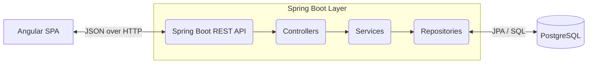

# Expense Tracker

A full-stack personal finance web application that allows users to track, categorise, budget, and analyse their spending habits.

## Technology Stack

### Frontend (Angular SPA)
* **Framework:** Angular 17+ (Standalone Components)
* **Language:** TypeScript
* **UI Library:** Angular Material
* **Styling:** SCSS

### Backend (Spring Boot REST API)
* **Framework:** Spring Boot 3+
* **Language:** Java
* **Security:** Spring Security 6 (JWT Filter Chain)
* **Data Access:** Spring Data JPA / Hibernate
* **Database Migration:** Flyway

### Database
* **Database:** PostgreSQL 15 (Supabase)

## Architecture

The application follows a layered enterprise architecture:



### Layer Responsibilities
- **Presentation (Angular):** SPA rendering, reactive forms, lazy-loaded feature modules.
- **API Layer (Spring MVC):** HTTP routing, DTO mapping, request validation, response serialisation.
- **Business Logic (Spring @Service):** Expense aggregation, budget vs actual calculation.
- **Security (Spring Security):** Stateless authentication, CORS config, role-based security.
- **Data Access (Spring Data JPA):** Repository pattern, custom JPQL queries, ORM mapping.

## Setup and Run Locally

### 1. Database (Supabase / PostgreSQL)
1. Set up a free-tier project on [Supabase](https://supabase.com).
2. Collect the PostgreSQL connection string (host, port, dbname, user, password).
3. Update `backend/src/main/resources/application.yml` with your connection details.

### 2. Backend (Spring Boot)
1. Ensure you have Java 17+ installed.
2. Navigate to the `backend` directory:
   ```bash
   cd backend
   ```
3. Run the application:
   ```bash
   # Windows
   ./mvnw.cmd spring-boot:run
   # macOS/Linux
   ./mvnw spring-boot:run
   ```

### 3. Frontend (Angular)
1. Ensure you have Node.js and npm installed.
2. Navigate to the `frontend` directory:
   ```bash
   cd frontend
   ```
3. Install dependencies and start the development server:
   ```bash
   npm install
   npm start
   ```
4. Access the application at `http://localhost:4200/`.
