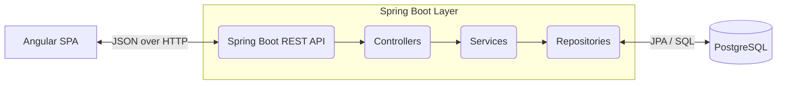

# Expense Tracker

A full-stack personal finance web application that allows users to track, categorise, budget, and analyse their spending habits with interactive charts, PDF/CSV exports, and secure JWT authentication.

## Technology Stack

### Frontend (Angular SPA)
* **Framework:** Angular 21.2 (Standalone Components)
* **Language:** TypeScript 5.9
* **UI Library:** Angular Material 21.2, Tailwind CSS 3.x
* **Styling:** SCSS, Tailwind CSS
* **Charts:** Chart.js 4.5 + ng2-charts 10.0
* **Testing:** Vitest 4.0

### Backend (Spring Boot REST API)
* **Framework:** Spring Boot 4.1
* **Language:** Java 17
* **Security:** Spring Security 6 (JWT Filter Chain)
* **Data Access:** Spring Data JPA / Hibernate
* **Database Migration:** Flyway
* **API Docs:** SpringDoc OpenAPI (Swagger UI)
* **Exports:** CSV, PDF (OpenPDF)

### Database
* **Database:** PostgreSQL 15 (Supabase)

## Architecture

The application follows a layered enterprise architecture with a decoupled SPA frontend and REST API backend:



### Layer Responsibilities
- **Presentation (Angular):** SPA rendering, reactive forms, lazy-loaded feature modules, app shell layout with navbar/sidebar.
- **API Layer (Spring MVC):** HTTP routing, DTO mapping, request validation, response serialisation.
- **Business Logic (Spring @Service):** Expense aggregation, budget vs actual calculation, profile management, password changes, PDF/CSV export.
- **Security (Spring Security):** Stateless JWT authentication, configurable CORS origins, role-based security.
- **Data Access (Spring Data JPA):** Repository pattern, custom JPQL queries, projection interfaces, ORM mapping.

## Key Features

- **JWT Authentication** - Register, login, profile update, password change
- **Expense CRUD** - Create, read, update, delete with category filter, keyword search, and server-side pagination
- **CSV/PDF Export** - Export expenses with date range filtering
- **Category Management** - 9 pre-seeded defaults + custom categories with icon/colour
- **Budget Management** - Monthly budgets per category with upsert logic
- **Analytics Dashboard** - Category breakdown (pie), monthly trend (bar), daily trend (line), yearly summary powered by Chart.js & ng2-charts
- **Profile Settings** - Update display name, change password
- **Responsive App Shell** - Dynamic route titles, current month indicator, and sidebar layout with route guards

## Setup and Run Locally

### 1. Database & Environment Setup
1. Set up a free-tier project on [Supabase](https://supabase.com).
2. Collect the PostgreSQL connection string. Use the **Session Pooler (Port 5432)**:
   `jdbc:postgresql://aws-0-<region>.pooler.supabase.com:5432/postgres?sslmode=require`
3. Copy `.env.example` to `.env` in the root (or in `backend/` and `frontend/`):
   ```bash
   cp .env.example .env
   ```
4. Set your database credentials in `.env` (or pass them as environment variables).

### 2. Backend (Spring Boot)
1. Ensure you have Java 17+ installed.
2. Navigate to the `backend` directory:
   ```bash
   cd backend
   ```
3. Run the application:
   ```bash
   # Windows
   ./mvnw.cmd spring-boot:run
   # macOS/Linux
   ./mvnw spring-boot:run
   ```
4. The API starts at `http://localhost:8080`. Swagger UI available at `http://localhost:8080/swagger-ui.html`.

### 3. Frontend (Angular)
1. Ensure you have Node.js 22+ and npm 9+ installed.
2. Navigate to the `frontend` directory:
   ```bash
   cd frontend
   ```
3. Install dependencies and start the development server:
   ```bash
   npm install
   npm start
   ```
4. Access the application at `http://localhost:4200/`.

## REST API Endpoints

Base URL: `http://localhost:8080/api/v1`

| Method | Endpoint | Description | Auth |
|---|---|---|---|
| `GET` | `/health` | Service health & wake-up ping | ❌ |
| `POST` | `/auth/register` | Register a new user | ❌ |
| `POST` | `/auth/login` | Login with credentials | ❌ |
| `PUT` | `/auth/me` | Update user profile (name) | ✅ |
| `PUT` | `/auth/change-password` | Change password | ✅ |
| `GET` | `/expenses` | List expenses (paginated, filterable) | ✅ |
| `GET` | `/expenses/{id}` | Get single expense | ✅ |
| `POST` | `/expenses` | Create expense | ✅ |
| `PUT` | `/expenses/{id}` | Update expense | ✅ |
| `DELETE` | `/expenses/{id}` | Delete expense | ✅ |
| `GET` | `/expenses/export/csv` | Export as CSV | ✅ |
| `GET` | `/expenses/export/pdf` | Export as PDF | ✅ |
| `GET` | `/categories` | List all categories | ✅ |
| `POST` | `/categories` | Create custom category | ✅ |
| `PUT` | `/categories/{id}` | Update custom category | ✅ |
| `DELETE` | `/categories/{id}` | Delete custom category | ✅ |
| `GET` | `/budgets?month=&year=` | List budgets for a month | ✅ |
| `POST` | `/budgets` | Create or update budget | ✅ |
| `DELETE` | `/budgets/{id}` | Delete budget | ✅ |
| `GET` | `/budgets/summary?month=&year=` | Budget vs. actual summary | ✅ |
| `GET` | `/analytics/category-breakdown?month=&year=` | Category spending breakdown | ✅ |
| `GET` | `/analytics/monthly-trend?year=` | Monthly spending trend | ✅ |
| `GET` | `/analytics/yearly-summary` | Year-to-date summary | ✅ |

## 🚀 Cloud Deployment

### Frontend (Vercel)
- **Root Directory:** `frontend`
- **Framework Preset:** `Angular`
- **Output Directory:** `dist/frontend` (configured with `outputPath.browser: ""` in `angular.json`)
- **SPA Rewrites:** Configured in `frontend/vercel.json` (`/(.*) -> /index.html`)

### Backend (Render)
- **Environment:** Docker (`Dockerfile` building Java 17 executable jar)
- **Branch:** Ensure Render is pointing to your active deployment branch (e.g., `development` or `main`)
- **Environment Variables:**
  - `SPRING_DATASOURCE_URL`: `jdbc:postgresql://<pooler-host>:5432/postgres?sslmode=require`
  - `SPRING_DATASOURCE_USERNAME`: `postgres.<project-ref>`
  - `SPRING_DATASOURCE_PASSWORD`: `<supabase-db-password>`
  - `APP_JWT_SECRET`: 256-bit secret key
  - `APP_CORS_ALLOWED_ORIGINS`: Comma-separated frontend origins (e.g., `https://expense-tracker-pi-indol-14.vercel.app`)

### Auto Wake-up Ping
When visitors load the Angular frontend, `App.ngOnInit()` automatically issues a background `fetch()` to `/health` to wake up the Render free-tier container before the user submits their login or registration form.

## Project Structure

```text
Expense Tracker/
├── .env.example                       # Root environment variables template
├── backend/                           # Spring Boot REST API
│   ├── .env.example                   # Backend environment template
│   ├── Dockerfile                     # Container definition for Render
│   ├── src/main/java/...              # Source code (Controllers, Services, Models, Repositories)
│   ├── src/main/resources/            # Application config (application.yml) & Flyway migrations
│   └── src/test/...                   # Unit & Integration tests
├── frontend/                          # Angular SPA
│   ├── .env.example                   # Frontend environment template
│   ├── vercel.json                    # Vercel SPA routing configuration
│   ├── src/app/                       # Angular application code
│   │   ├── core/                      # Singleton services & guards
│   │   ├── features/                  # Lazy-loaded feature modules (Auth, Dashboard, Expenses, etc.)
│   │   └── shared/                    # Reusable components
│   └── src/environments/              # Environment configs (dev & prod)
└── .gitignore
```

## Testing Strategy

- **Frontend:** Components and services are tested using **Vitest** and the **Angular Testing Library**. Mocks are utilized extensively to isolate behaviors, such as mocking API responses and browser `localStorage`.
- **Backend:** Testing is handled with **JUnit** and **Spring Boot Test**. Includes context load tests to verify beans and dependencies, and integration tests to validate JPA repositories and REST controllers.
